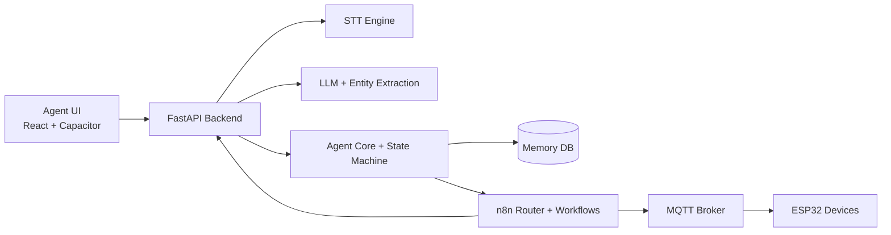

# PCD AI Embedded Agent

An end-to-end voice AI platform for web, mobile, and embedded IoT.

## Maintainers

- Montassar
- Omar
- Amine

## Overview

This repository contains everything needed to run a multimodal AI assistant:

- Python FastAPI backend for text/audio command processing
- React + Vite + Capacitor client for web and Android usage
- n8n workflows for controlled action execution
- MQTT integration for ESP32 and smart devices

The assistant supports two major paths:

1. Conversation path: transcription, understanding, response generation, optional TTS
2. Action path: intent extraction, Action JSON draft, confirmation, secure execution

## Core Capabilities

- Real-time audio or text command handling
- Conversation vs action classification
- Action confirmation workflow with state tracking
- Multilingual support (English, French, Arabic)
- Wake mode and push-to-talk UI modes
- IoT execution through n8n + MQTT
- Persistent memory service (SQLite)

## High-Level Architecture



## Repository Layout

```text
pcd-ai-embedded-agent/
|- backend/            # FastAPI backend and orchestration
|- agent-ui/           # React/Vite frontend + Capacitor Android app
|- n8n/                # Workflow definitions and integration scripts
|- esp32/              # ESP32 firmware and hardware prototypes
|- tests/              # Integration and validation tests
|- doc/                # Architecture and technical documentation
```

## Quick Start

### 1) Backend setup

```powershell
cd backend
Copy-Item .env.example .env
.\install_backend.ps1
.\start_backend.ps1
```

Or manual start:

```bash
python -m uvicorn backend.main:app --reload --host 0.0.0.0 --port 8000
```

API docs:

- Swagger: http://localhost:8000/docs
- ReDoc: http://localhost:8000/redoc

### 2) Frontend setup

```bash
cd agent-ui
npm install
npm run dev
```

Frontend URL:

- http://localhost:5173

## Important Configuration

### Backend environment

Use backend/.env for runtime values. Common keys:

- DEFAULT_LANGUAGE
- FORCE_LLM_RESPONSE_LANGUAGE
- FORCE_STT_LANGUAGE
- ENABLE_N8N_INTEGRATION
- ENABLE_MQTT_INTEGRATION
- DEMO_MODE
- N8N_WEBHOOK_URL
- MQTT_BROKER
- MQTT_PORT

Use backend/.env.example as the team template.

### Frontend environment

Optional override in agent-ui/.env:

```env
VITE_BACKEND_URL=http://YOUR_PC_IP:8000
```

Without it, the UI auto-detects backend URL based on runtime context.

## Main API Endpoints

- POST /command/text
- POST /command/audio
- POST /action/confirm/{action_id}
- GET /action/status/{action_id}
- GET /actions/{user_id}
- POST /callback/n8n
- POST /robot/state
- GET /memory/{user_id}
- GET /health
- GET /stats

Configuration endpoints:

- GET|POST|DELETE /config/devices
- POST|DELETE /config/device-aliases
- GET|POST|PUT|DELETE /config/contacts
- POST|DELETE /config/contact-aliases

## Mobile App with Capacitor (Android)

The mobile app is built from agent-ui and synced to Android via Capacitor.

```bash
cd agent-ui
npm install
npm run build:mobile
npx cap sync android
npx cap open android
```

See the complete UI/mobile guide in [agent-ui/README.md](agent-ui/README.md).

## n8n and IoT

- n8n workflows are in n8n/
- MQTT bridge supports robot state and TTS playback topics
- ESP32 firmware is documented in [esp32/README.md](esp32/README.md)

## Testing

```bash
pytest backend -v
pytest tests -v
```

PowerShell integration scripts:

- test_api_endpoints.ps1
- test_backend_pas_a_pas.ps1
- n8n/test_pipeline.ps1

## Documentation Index

Start from [doc/README.md](doc/README.md) for architecture, API, installation, and demos.

## Security Notes

- Do not commit backend/.env with real secrets.
- Keep backend/.env.example updated for teammates.
- Restrict CORS and rotate keys for production deployments.

## License

This project is licensed under the Apache License 2.0.
See [LICENSE](LICENSE).
